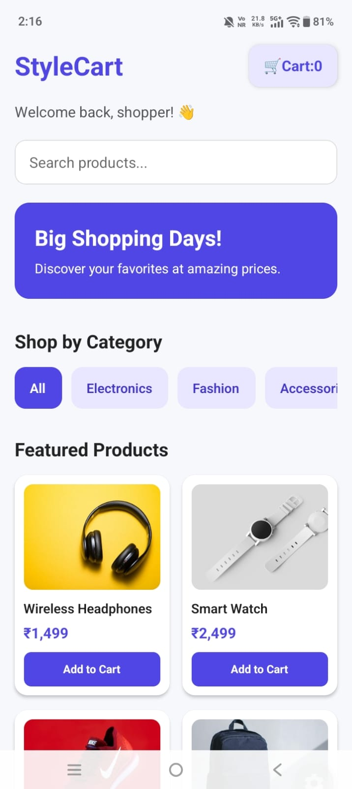

# React Native Assignment 2 – Product Listing

## Project Description
This project is an e-commerce mobile application developed using React Native and Expo. It demonstrates reusable components, product listing, FlatList, and mobile-friendly styling.

## Features
- Displays at least 8 sample products.
- Shows product images, names, prices, and categories.
- Uses a reusable ProductCard component.
- Uses FlatList to display products efficiently.
- Uses unique product IDs with keyExtractor.
- Provides touch interaction when a product is selected.
- Displays a friendly message when no products are available.
- Uses local sample data without connecting to backend APIs.

## Technologies Used
- React Native
- Expo
- JavaScript
- Expo Router

## Project Structure

- `src/app/` – Application screens and routes
- `src/components/ProductCard.tsx` – Reusable product card component
- `src/data/products.js` – Sample product data
- `assets/` – Images and other static assets

## Getting Started

### Prerequisites
Install Node.js and npm before running the project.

### Installation
Open the terminal in the project directory and run:

```bash
npm install
```

### Start the Application
Run:

```bash
npx expo start
```

Follow the terminal instructions to open the application on a compatible device or emulator.

## Key Concepts Learned
- Creating reusable React Native components
- Passing data through props
- Rendering lists using FlatList
- Using keyExtractor with unique IDs
- Styling components with StyleSheet and Flexbox
- Handling touch interactions with Pressable
- Separating sample data from UI components

## Assignment Details
**Assignment:** React Native – Assignment 2  
**Topic:** Reusable Components, Product Listing & FlatList  
**Project:** E-Commerce Mobile App

## Screenshot

### Product Listing Screen




## Research Questions

**1. Why use FlatList instead of ScrollView?**

FlatList efficiently renders list items and is suitable for lists containing many products. ScrollView renders all its children at once.

**2. Why is keyExtractor important?**

keyExtractor provides a unique key for each list item, helping React identify items when the list changes.

**3. Why should product IDs be unique?**

Unique IDs help React identify each product correctly and prevent key-related rendering issues.

**4. What is the difference between props and state?**

Props pass data from a parent component to a child component. State stores data that a component manages and can update.

**5. Why separate data from UI components?**

Separating data from UI improves code organization, readability, reuse, and maintenance.

**6. Why use a two-column product grid?**

A two-column grid displays more products within the available mobile screen width and makes product browsing compact.